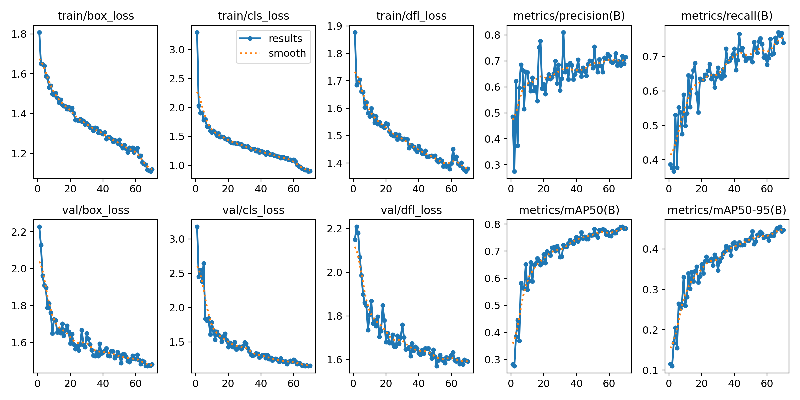
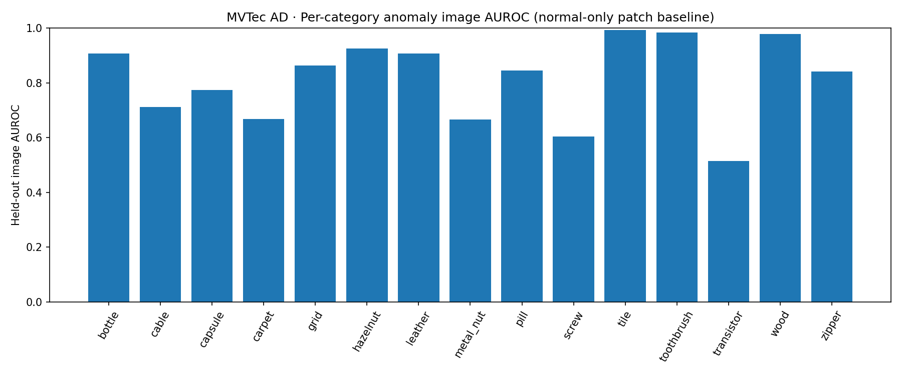

# DefectSpot

**Day 22 / 100 — Industrial Visual Quality Intelligence**  
**Research prototype | Real inference | Evidence-first reporting | Human-in-the-loop**

[](backend/) [](frontend/) [](models/) [](#scope-and-claim-boundaries)

> **Important:** This repository contains **two different computer-vision research tasks**, not a single universal quality-control model. NEU-DET predicts steel-defect bounding boxes. MVTec AD generates category-specific anomaly scores and coarse heatmaps. Neither provides a calibrated, certified manufacturing pass/fail decision.

**Repository:** https://github.com/MENSTRUE/DefectSpot  
**Author:** Wafa Bila Syaefurokhman (`MENSTRUE`)  
**Series:** 100 Days of Projects — Day 22

## Contents

1. [Executive summary](#executive-summary)
2. [Before → Now → Next](#before--now--next)
3. [Screenshot gallery](#screenshot-gallery)
4. [System architecture](#system-architecture)
5. [Repository structure](#repository-structure)
6. [Datasets, lineage and access](#datasets-lineage-and-access)
7. [Audit and leakage controls](#audit-and-leakage-controls)
8. [Methods and model contracts](#methods-and-model-contracts)
9. [Research metrics](#research-metrics)
10. [Local setup](#local-setup)
11. [API usage](#api-usage)
12. [Testing and validation](#testing-and-validation)
13. [Reproducibility](#reproducibility)
14. [Deployment and security](#deployment-and-security)
15. [Scope and claim boundaries](#scope-and-claim-boundaries)
16. [Limitations](#limitations)
17. [Roadmap](#roadmap)
18. [Troubleshooting](#troubleshooting)
19. [FAQ](#faq)
20. [License, attribution and responsible use](#license-attribution-and-responsible-use)

## Executive summary

DefectSpot investigates two complementary questions relevant to visual industrial inspection:

| Question | Pipeline | Output | Input domain |
|---|---|---|---|
| **Where is a known surface defect, and what kind is it?** | **NEU-DET**, supervised YOLOv8n | Six defect classes, bounding boxes, confidences, annotated JPEG | Steel surfaces resembling the NEU-DET dataset |
| **Which regions depart from learned normal appearance?** | **MVTec AD**, handcrafted normal-only patch reference + nearest neighbor | Raw anomaly distance, 16×16 patch-distance map, optional heatmap overlay | One of 15 MVTec categories, selected explicitly |

Both models run behind the same **FastAPI** app, exposed through a **React + TypeScript + Vite** browser UI. Predictions come from real stored checkpoints (`.pt` / `.joblib`); research statistics come from saved executed reports. The UI does **not** invent metrics or convert anomaly distances to probabilities.

**Current functional evidence:** The user has exercised NEU-DET with one image from each of the six classes; the MVTec `bottle` route returned a raw score and overlay for both a held-out `good` image and a held-out `broken_large` image. Example scores were **0.7583 (good_01)** and **0.9847 (broken_large_01)**; these are **two example inferences, not an accuracy estimate or threshold**. The held-out aggregate metrics below remain the authoritative research evidence.

## Before → Now → Next

| Stage | Description | Evidence/status |
|---|---|---|
| **Before** | Define independent research questions, inspect both input datasets, validate annotation structure and possible leakage, design a non-fabricated baseline. | Dataset inventory and audits in `reports/`, source notebook under `notebooks/`. |
| **Now** | NEU-DET and MVTec patch-bank runtime integrated with FastAPI and React. Browser inspection and JSON/image exports are available; illustrative tests performed. | `backend/app/main.py`, `backend/app/api/routes/mvtec.py`, `frontend/src/`, screenshots. **Research prototype**, not manufacturing deployment. |
| **Next** | Add repeatable API integration tests, CI, environment pinning, operating-point validation with separate validation data, category-level monitoring, UI consistency, security hardening and production readiness review. | Roadmap below. |

### What is demonstrably implemented

- Real YOLO checkpoint loading and **strict class-order contract check** (`models/neu_best.pt`).
- Category-specific trusted MVTec `.joblib` bank loading, schema checks, faithful notebook feature extraction and 5%-tail image score.
- Upload validation (JPEG/PNG/WebP; 10 MiB; 16-million-pixel safety limit), structured inference responses.
- Local UI for NEU detections and MVTec original/overlay comparison; no quality-release verdict.
- Notebook evaluation, metrics, dataset integrity records, per-category reports and visual plots.

### Not yet established

- Reliable machine-level defect acceptance threshold, calibrated probabilities, real factory deployment, continuous video inspection, real-time line-speed SLA, comprehensive dataset licensing clearance or independent field testing.

## Screenshot gallery

All images below are **committed repository assets**, not generated mock-ups. Keep filenames unchanged unless the Markdown links are updated.

| NEU inspection examples | MVTec anomaly examples |
|---|---|
|  |  |
|  |  |

> Screenshot content shows demonstration sessions, not held-out benchmarking results. Check the images before changing captions or assigning specific sample identities.

### Research figures





More available in [`assets/plots/`](assets/plots/). Separate training curves from final test outcomes when presenting results.

## System architecture

```text
                  Browser / React + Vite (5173)
                  ├── NEU-DET inspection panel
                  ├── MVTec AD anomaly panel
                  ├── Model insights and research context
                  └── JSON/JPEG exports
                                │ /api (Vite dev proxy)
                                ▼
                      FastAPI backend (8000)
                    ┌───────────┴───────────┐
                    ▼                       ▼
           POST /predict/neu       POST /predict/mvtec
             YOLOv8n (.pt)          Category bank (.joblib)
           class-order check       exact 14-D handcrafted descriptor
           6-class detection       normalized NN patch distances
           bounding boxes         top 5% mean + 16×16 heatmap
                    └───────────┬───────────┘
                                ▼
                        Browser observations
                    (quality verdict NOT assessed)
```

- The frontend's dev proxy is defined in `frontend/vite.config.ts`.
- Source research and deployed inference are separate: notebook is **not executed at request time**.
- `.joblib` serialization is executable on load; load **only trusted repository-generated artifacts**, not user uploads.

## Repository structure

This is an inventory of the **observed `main` branch**, grouped for readability. Some scaffold directories contain only `.gitkeep` and are **not operational subsystems**.

```text
DefectSpot/
├── README.md                           # Project front door (this document)
├── AGENTS.md                           # Repository-wide contributor/AI-agent rules
├── LICENSE                             # MIT for original software; see third-party caveats
├── .gitignore
├── notebooks/
│   └── defectspot.ipynb                # Executed research, discovery, training, evaluation
├── models/
│   ├── neu_best.pt                     # Selected YOLOv8n checkpoint
│   ├── neu_best.onnx                   # Optional export artifact
│   └── mvtec_patch_<category>.joblib   # 15 category-specific reference banks
├── reports/
│   ├── final_summary.json              # Project-level research summary
│   ├── neu_heldout_metrics.json        # NEU 270-image test metrics
│   ├── neu_split_audit.json            # Group split evidence
│   ├── neu_*_manifest.csv              # Train/val/test provenance manifests
│   ├── mvtec_summary.json              # MVTec macro statistics
│   ├── mvtec_heldout_metrics.csv       # MVTec category-level metrics
│   ├── mvtec_test_predictions.csv      # Test predictions and labels
│   ├── mvtec_integrity.json            # Category-level train/test hash audit
│   ├── mvtec_memory_audit.json         # Normal-bank sizes/coverage
│   ├── mvtec_fiftyone_*.json           # Flat/FiftyOne data discovery
│   ├── model_contract_inspection.json  # Saved artifact contract inspection
│   └── environment.json               # Kaggle training configuration
├── backend/
│   ├── requirements.txt
│   ├── AGENTS.md                        # Contribution rules for backend
│   ├── app/
│   │   ├── main.py                     # App, NEU routes, health, model catalog
│   │   ├── api/routes/mvtec.py         # MVTec API routes
│   │   └── inference/anomaly/mvtec.py  # Patch features, bank loading, scoring
│   └── tests/test_mvtec_features.py    # MVTec feature unit test
├── frontend/
│   ├── README.md                       # UI-specific guide
│   ├── AGENTS.md                       # Contribution rules for frontend
│   ├── package.json / package-lock.json
│   ├── vite.config.ts
│   └── src/
│       ├── App.tsx / api.ts / style.css
│       ├── vite-env.d.ts
│       └── components/inspection/
│           ├── MvtecInspection.tsx
│           └── MvtecInspection.css
├── assets/
│   ├── screenshots/                    # Four committed dashboard screenshots
│   └── plots/                          # Training/evaluation visuals
├── scripts/inspect_artifacts.py        # Trusted local artifact introspection
└── docs/
    ├── id/                             # Bahasa Indonesia guides
    └── en/                             # English technical guides
```

The packaging may add documentation files that are not part of the original checkout until committed. Do **not** advertise empty directories as implemented features.

## Datasets, lineage and access

### NEU-DET — supervised detection

- **Recorded Kaggle input:** `/kaggle/input/datasets/wafabila/neu-det`.
- **Research task:** locate/classify six NEU steel defects: `crazing`, `inclusion`, `patches`, `pitted_surface`, `rolled-in_scale`, `scratches`.
- **Annotation handling:** read Pascal VOC XML, validate bounding boxes/class IDs and pair source images to labels; convert to YOLO-format staged data for training.
- **Split:** 1,259 train / 270 validation / 270 final test. These counts are from `reports/neu_split_audit.json`, not an assumed 70/15/15 exact split.
- **Staging:** training/validation selection uses only the appropriate partitions; held-out test belongs to final evaluation.

### MVTec AD — normal-only patch anomaly

- **Recorded Kaggle input:** `/kaggle/input/datasets/wafabila/mvtec-ad-dataset`.
- **15 categories:** `bottle`, `cable`, `capsule`, `carpet`, `grid`, `hazelnut`, `leather`, `metal_nut`, `pill`, `screw`, `tile`, `toothbrush`, `transistor`, `wood`, `zipper`.
- **Source layout:** FiftyOne-style export may store pictures under `mvtec-ad/data/data_*` with labels/split in `mvtec-ad/samples.json`, rather than directly in category folders. Notebook preprocessing resolves source layout; do not guess a label from an opaque filename.
- **Reference bank:** fit on training `good` images **only**, 12,000 patch descriptors maximum per category, sampled by reservoir sampling.
- **Evaluation:** source test images with good/defective labels and original masks; the held-out test total is 1,725 across 15 categories.
- **External UI test:** one known `bottle/test/good` image and one `bottle/test/broken_large` image were used as a functionality check, not for model selection.

### Dataset policy

The repository tracks **manifests and derived metrics**, not full Kaggle source datasets. Retain provenance, class maps, source version/license, split identity and preprocessing in any replication. Never silently mix steel-defect detection labels with MVTec anomaly categories.

## Audit and leakage controls

| Control | Recorded evidence | Scope / residual risk |
|---|---|---|
| Dataset discovery & integrity | `reports/source_inventory.json`, `reports/mvtec_inventory.csv`, `reports/neu_annotation_audit.json` | Verify file formats, source pairing and expected categories. |
| NEU exact content duplicates | `reports/neu_split_audit.json` | **1 exact duplicate excluded**; exact hash union and filename-family grouping. |
| NEU split class coverage | `reports/neu_split_audit.json` | No class missing from train, val or test; grouped by source-family heuristic. |
| NEU test provenance | `reports/neu_test_manifest.csv` and train/val manifests | Test separated before model selection. |
| MVTec train/test integrity | `reports/mvtec_integrity.json` | **0 exact train/test hash overlaps** for each of 15 categories; **0 missing defect masks** in audited source. |
| MVTec normal-only bank | `reports/mvtec_memory_audit.json` and `notebooks/defectspot.ipynb` | No test anomalies used to build normal reference bank. |
| Model contracts | `reports/model_contract_inspection.json` and backend runtime checks | Confirm schema/features/category at load time; checkpoint provenance still matters. |

**Important limitations:** An exact SHA-256 mismatch does **not** prove that near-duplicates or scene-level related images are absent. A filename-family heuristic is conservative but incomplete. The current reports are evidence for the recorded run, not guarantees for changed future datasets.

## Methods and model contracts

### Pipeline A — NEU-DET: YOLOv8n

- Initialization: pretrained `yolov8n.pt`.
- Training: up to 70 epochs, patience 20, image size 640, batch size 16, seed 42, training workers 2 (see `reports/environment.json`).
- Checkpoint: `models/neu_best.pt`; `models/neu_best.onnx` is a separate optional exported artifact, not proof of the deployed inference path.
- Runtime: `ultralytics.YOLO` loading trusted `.pt`, task must be `detect`, ordered class names must exactly match the six-class contract.
- Input: uploaded JPEG/PNG/WebP decoded with EXIF orientation.
- Output: `detections[]` with `class_id`, `class_name`, confidence and `bbox` in absolute XYXY pixel coordinates; `detection_count`, `inference_ms`, optional `annotated_image_base64`, `quality_decision: not_assessed`.
- Confidence: browser default 0.25. Changing confidence changes displayed detections, **not retraining or scientific evaluation metrics**.

### Pipeline B — MVTec AD: handcrafted normal-only nearest-neighbor baseline

This model is **not PatchCore**, **not YOLO**, and **not a supervised defect classifier**. Implemented algorithm:

1. Decode image as RGB; resize **128×128** with OpenCV `INTER_AREA`.
2. Partition into **16×16 patches** of 8×8 pixels.
3. Build **14-dimensional** descriptors per patch: Lab color channel means/std (6), gray mean/std (2), Sobel magnitude mean/std (2), absolute Laplacian mean (1), gray percentiles P10/P50/P90 (3).
4. Normalize features using bank-specific training-only `mu` and `sigma` (sigma floor `1e-3` during bank fitting).
5. Calculate nearest-neighbor distances against the category's normal reference bank (`sklearn.neighbors.NearestNeighbors`).
6. Image raw anomaly score = **mean of the largest `ceil(0.05 × 256) = 13` patch distances**.
7. Map distances to a **16×16 coarse grid**; optional heatmap is min/max scaled **per image for display only**, upsampled and alpha-blended.

Bank schema: `{'nn','mu','sigma','resize','grid','category','approach'}`. The runtime verifies expected keys, category, resize 128, grid 16 and 14-feature mean/scale. Input is category-specific; wrong category yields untrustworthy interpretation even if API runs.

**No global anomaly threshold has been validated.** A raw distance is not a defect probability. Because overlay normalization is per-image, colors between two outputs are **not a comparable anomaly scale**.

## Research metrics

> **SOURCE OF TRUTH:** [`reports/final_summary.json`](reports/final_summary.json), [`reports/neu_heldout_metrics.json`](reports/neu_heldout_metrics.json), [`reports/mvtec_heldout_metrics.csv`](reports/mvtec_heldout_metrics.csv), [`reports/mvtec_summary.json`](reports/mvtec_summary.json). All numbers below are historical executed research results, **not live browser telemetry**. Do not alter numbers to match presentation targets.

### NEU-DET: grouped held-out test (270 images)

| Metric | Recorded test value |
|---|---:|
| Precision | **0.718906** (71.89%) |
| Recall | **0.736539** (73.65%) |
| mAP@0.50 | **0.785180** (78.52%) |
| mAP@0.50:0.95 | **0.460330** (46.03%) |

**AP@0.50:0.95 by defect class**

| Crazing | Inclusion | Patches | Pitted surface | Rolled-in scale | Scratches |
|---:|---:|---:|---:|---:|---:|
| 0.1729 | 0.4616 | 0.6153 | 0.6122 | 0.3301 | 0.5699 |

These varying class-level values matter: aggregate accuracy-like statements obscure weaker defect types. False positives and misses remain possible.

### MVTec AD: 15 categories, 1,725 test images

| Metric | Recorded value | Interpretation |
|---|---:|---|
| **Macro image AUROC** | **0.811720** (81.17%) | Mean across 15 categories, not a binary-classification accuracy. |
| **Macro coarse pixel AUROC** | **0.888239** (88.82%) | Measured on **16×16 patch grid**, not full-resolution segmentation and **not official MVTec benchmark protocol**. |

Category-level per-image AUROC/AP and coarse pixel metrics are in `reports/mvtec_heldout_metrics.csv`. AP changes with defect prevalence; do not interpret it as precision at a fixed operating point.

### Demonstration pair (not a benchmark)

| Verified MVTec bottle test sample | Raw anomaly score | Measured per-request runtime |
|---|---:|---:|
| `good_01.png` | 0.7583 | 79.7 ms |
| `broken_large_01.png` | 0.9847 | 84.0 ms |

The score increases by 0.2264 for this **single example pair**, consistent with desired ordering, but it does **not** prove accuracy, calibration, recall, reliable localization, or a general pass/fail rule. Times depend on local device/runtime and are not throughput guarantees.

## Local setup

### Prerequisites

- Windows PowerShell commands below; macOS/Linux may use equivalent shell syntax.
- Python with a compatible PyTorch/Ultralytics/OpenCV/scikit-learn environment. Research training used Python 3.13.15 and Torch 2.11.0+cu128, but this is **not a fully pinned lockfile** for local serving.
- Node.js and npm compatible with the Vite version in `frontend/package-lock.json`.
- Verified checkpoints present in `models/`. **Do not download arbitrary `.pt` or `.joblib` files from strangers.**

### Backend: first install

```powershell
cd "D:\porto\100 day\day 22\DefectSpot\backend"
python -m venv .venv
.\.venv\Scripts\python.exe -m pip install --upgrade pip
.\.venv\Scripts\python.exe -m pip install -r requirements.txt
.\.venv\Scripts\python.exe -m pip install pytest
.\.venv\Scripts\python.exe -m uvicorn app.main:app --reload --host 127.0.0.1 --port 8000
```

`backend/requirements.txt` is the currently committed application dependency specification; it uses **ranges**, not immutable exact versions. `opencv-python` is currently installed transitively via Ultralytics on typical setups; if running only an isolated MVTec environment, explicitly ensure `cv2` is installed. Verify environments before claiming complete reproducibility.

Open **http://127.0.0.1:8000/docs**. The app serves local model inference; no production authentication is implemented.

### Frontend: second terminal

```powershell
cd "D:\porto\100 day\day 22\DefectSpot\frontend"
npm ci
npm run build
npm run dev
```

Open **http://127.0.0.1:5173/**. For local development, `/api` is proxied to the FastAPI server by Vite. If the backend is offline, React can render but inference requests will fail. See also `frontend/README.md`.

### Example workflow

1. Choose **NEU-DET** for a steel-defect sample; upload one JPEG/PNG/WebP, set confidence, inspect boxes and export JSON/JPEG.
2. Choose **MVTec AD** for a category-matched product photo; select the category (`bottle`, etc.), upload, run anomaly inspection and inspect raw score and 16×16 coarse overlay.
3. Do **not** treat “Not assessed” as a defective/normal classification. Human quality review is explicitly required.

## API usage

Local API base: `http://127.0.0.1:8000/api/v1`. Exact route definitions: [`backend/app/main.py`](backend/app/main.py) and [`backend/app/api/routes/mvtec.py`](backend/app/api/routes/mvtec.py).

| Verb + endpoint | Description |
|---|---|
| `GET /health` | API status, NEU checkpoint file presence, MVTec bank count. **Presence is not full contract validation.** |
| `GET /models` | Model names, classes/categories, task status. |
| `GET /mvtec/categories` | List 15 category bank names + checkpoint file availability. |
| `POST /predict/neu` | Multipart `file`, query `confidence=0.25`, `include_annotated=true`. |
| `POST /predict/mvtec` | Multipart `file`, required query `category=bottle`, optional `include_overlay=true`. |

**NEU example:**

```powershell
curl.exe -X POST "http://127.0.0.1:8000/api/v1/predict/neu?confidence=0.25&include_annotated=false" -F "file=@C:\path\to\steel_sample.jpg"
```

**MVTec example:**

```powershell
curl.exe -X POST "http://127.0.0.1:8000/api/v1/predict/mvtec?category=bottle&include_overlay=false" -F "file=@C:\path\to\bottle_test.png"
```

**Contracts:** Both routes accept only JPEG/PNG/WebP, up to **10 MiB** and **16 million pixels**. NEU has `detections`, `detection_count`, `quality_decision`; MVTec has `anomaly_score_raw`, `patch_distances`, `heatmap_grid`, `decision`, `overlay_jpeg_base64`. The schemas differ **by design**. Endpoint responses are **not persisted to a server-side inspection database**.

## Testing and validation

### Existing reproducible checks

```powershell
cd backend
.\.venv\Scripts\python.exe -m pytest tests/test_mvtec_features.py -q
```

```powershell
cd frontend
npm run build
npm run typecheck
```

The repository currently includes **MVTec feature unit tests**. Do not claim comprehensive backend integration tests, model parity CI, ONNX deployment tests or factory acceptance tests without adding them.

### Recommended end-to-end smoke test

- [ ] `GET /api/v1/health` returns JSON and expected file presence.
- [ ] `GET /api/v1/mvtec/categories` lists 15 category banks.
- [ ] Known NEU individual samples run and return class IDs 0–5, valid boxes and consistent image dimensions.
- [ ] Known MVTec `bottle` test samples `good` and `broken_large` load with category `bottle` and nonempty 16×16 map.
- [ ] Both browser routes show server-returned results; exports produce valid JSON and (when requested) images.
- [ ] Bad file format, oversized payload, invalid category and missing checkpoint fail safely with 4xx/503.
- [ ] Refresh browser and check API status; no stale prediction is shown for a newly selected file.
- [ ] Check current screenshot names against gallery and capture new versioned screenshots if UI changes.

For **scientific re-evaluation**, rerun notebook on original source datasets and review all split audits. Browser smoke tests do not replace held-out evaluation.

## Reproducibility

1. Preserve exact dataset provenance and license details (Kaggle `wafabila/neu-det` and `wafabila/mvtec-ad-dataset` mounts recorded in `reports/final_summary.json`).
2. Read `reports/environment.json` for seed 42, preprocessing, training hyperparameters and experimental software versions.
3. Run `notebooks/defectspot.ipynb` in an environment that can access source datasets; **do not accidentally run full training while trying to start the server**.
4. Audit all source images, label pairing, exact hashes and grouped splits before training. Stop on mismatches; never silently “repair” label semantics.
5. Select NEU checkpoint via validation, evaluate once on held-out test. For MVTec, fit banks only on `train/good`, measure test good/defective and masks without selecting thresholds on test.
6. Compare generated artifacts with committed `reports/*`; document differing software/library versions, datasets, seeds or changed protocols. Keep old results immutable until a new run is traceable.
7. Optional ONNX export does not certify parity; if using ONNX in deployment, explicitly compare outputs against trusted `.pt` before claiming equivalence.

### Source-of-truth hierarchy

1. **Executed notebook and raw output artifacts** for method and experiment settings.
2. **Versioned `reports/`** for measured metrics, provenance and audits.
3. **Actual `backend/` and `frontend/` source** for runtime capabilities and HTTP contracts.
4. **Actual committed `models/`** for supported checkpoints and bank categories.
5. **README, AGENTS, screenshots** explain these sources; when documentation conflicts, investigate the underlying code/reports and update docs rather than inventing metrics.

## Deployment and security

**Current state: local development only.** `uvicorn --reload`, local Vite proxy and permissive local workflow are not a hardened production service.

Before exposing this app outside localhost:

- Remove `--reload`; add appropriate process supervision, timeouts, memory limits, request-rate limits and logs.
- Introduce authentication/authorization if uploads, result histories or inspection images involve private facilities.
- Explicitly configure CORS to actual trusted origins; behind reverse proxy with TLS and upload size limits.
- Never load `.joblib` or `.pt` from arbitrary uploads; use trusted, hash-verified, pinned versions only.
- Treat uploads as untrusted, protect against decompression bombs and huge files, isolate inference workloads and monitor errors.
- Add per-model versioning, environmental reproducibility, audit trails and model-evaluation drift checks.
- Define business requirements, labeled field test set, human review procedure, escalation criteria and quality-inspection thresholds on validation data **before** even considering automated decisions.
- Audit the non-commercial MVTec dataset license and rights for pretrained checkpoints and NEU source before any commercial use.

Docker, hosted CI, production container images, multi-user management and manufacturing line PLC integration are **roadmap items**, not current implemented features.

## Scope and claim boundaries

| Supported statement | Unsupported statement |
|---|---|
| “Two real local inference pipelines are implemented.” | “A production-certified automatic QC system.” |
| “NEU held-out test mAP@50 was 0.7852 in the recorded run.” | “78.52% accuracy on all manufacturing defects.” |
| “MVTec macro image AUROC was 0.8117 over 15 categories.” | “81.17% of all products classified correctly.” |
| “MVTec produces category-specific uncalibrated distances and 16×16 heatmaps.” | “Anomaly score 0.98 means 98% probability of defect.” |
| “MVTec bottle demo defect example scored above one good example.” | “One example pair proves reliable defect detection.” |
| “An image shows model-proposed defect regions.” | “A green/red overlay establishes a pass/fail manufacturing verdict.” |
| “MVTec coarse pixel AUROC is 0.8882 on a 16×16 grid.” | “The detector provides accurate pixel-level segmentation.” |

**Rule:** keep human quality engineers in the decision loop. `not_assessed` is intentionally returned instead of pass/fail.

## Limitations

1. **Domain shift:** lighting, camera optics, scale, texture, background and product orientation can change raw distances or object detections.
2. **Small/uneven per-class performance:** NEU class-level AP varies substantially; do not suppress weak classes when reporting results.
3. **Coarse anomaly spatial resolution:** 16×16 nearest-neighbor patch map is a diagnostic heatmap, not defect-pixel boundaries.
4. **No calibrated decision rule:** no declared factory-specific false rejection / false acceptance operating point.
5. **Category-specific scores:** MVTec raw score magnitude must not be compared directly across categories or with NEU confidence.
6. **Exact duplicate ≠ visual duplicate:** residual scene/augmentation-family leakage risk remains.
7. **CPU/GPU latency is environment-dependent:** two browser screenshots or six sample images are insufficient to claim line-speed throughput.
8. **Security and operations:** local dev CORS, lack of production auth, `joblib` deserialization risk, no persistent audit database.
9. **License constraints:** MVTec AD under CC BY-NC-SA 4.0; model/image redistribution and commercial use require rights review.
10. **Limited test coverage:** feature unit tests and manual demonstrations do not substitute for automated regression, integration and deployment tests.

## Roadmap

| Priority | Work item | Acceptance condition |
|---|---|---|
| P0 | Document actual repo, update stale frontend documentation | README and AGENTS correctly match both implemented routes and current screenshot paths. |
| P0 | Maintain functional parity after refactor | Build/typecheck passes; six NEU classes and bottle normal/anomaly still run. |
| P1 | Add HTTP integration tests & CI | Every endpoint has positive/negative tests; GitHub Actions reports status. |
| P1 | Version model and feature contracts | Hashes, inference versions and descriptor parity checks saved. |
| P1 | MVTec validation-set threshold study | Per-category calibrated operating rules with independent holdout, no test leakage. |
| P1 | Better MVTec heatmap legend | Clear per-image scaling warning and optional fixed-range diagnostic mode. |
| P2 | Robust error handling and performance profiles | Consistent API errors, limits, CPU/GPU benchmark under defined conditions. |
| P2 | UI unification and accessibility | Both pipelines share visual language, upload controls, export and keyboard access. |
| P2 | Containerized reproducible demo | Tested Docker setup, pinned dependencies, security review. |
| Future | Field dataset, human feedback, decision governance | Annotated factory data, external validation and operator sign-off. |

## Troubleshooting

| Symptom | Likely cause | Resolution |
|---|---|---|
| Browser shows API Offline | FastAPI not started or Vite proxy points to wrong port | Open `/api/v1/health` directly; run uvicorn on 8000; check `vite.config.ts`. |
| Python cannot import `app` | Running uvicorn from repo root instead of `backend/` | `cd backend` before `python -m uvicorn app.main:app ...`. |
| `neu_best.pt` missing / HTTP 503 | Missing checkpoint or failed class contract | Check `models/neu_best.pt`, `NEU_CLASSES`, backend logs. |
| MVTec HTTP 503 | Wrong category or missing/corrupted bank/schema | Verify 15 trusted files `models/mvtec_patch_<category>.joblib`; check runtime logs. |
| MVTec HTTP 501 | Old backend version still serving a placeholder route | Restart current backend and check `/docs`; ensure only one `/predict/mvtec` route exists. |
| Image rejected (415/413/422) | Format, byte limit, pixel limit, corrupt image | Use valid JPG/PNG/WebP ≤10 MiB and ≤16MP. |
| No NEU boxes | Threshold/domain or model miss | Try a known held-out sample; check 0.25 threshold; **do not mark image defect-free automatically**. |
| MVTec score surprisingly high on normal image | Domain mismatch, wrong category, normal variation | Verify source category and compare against original labeled MVTec test data; raw score is uncalibrated. |
| `ImportMeta.env` TypeScript error | Missing Vite types | Ensure `frontend/src/vite-env.d.ts` exists and is included. |
| `showOverlay` unused TypeScript error | Stale component with unused state | Remove unused state or implement control, then `npm run build`. |
| `npm ci` fails | Corrupt/missing lockfile or Node version issue | Confirm `frontend/package-lock.json` and use supported Node/npm. |
| ONNX present but backend uses `.pt` | Optional export not wired to runtime | Intended: live NEU runtime loads `.pt`; ONNX requires a separate validated serving path. |
| Test code fails with `cv2` missing | OpenCV absent in active virtualenv | Install `opencv-python` in that environment and pin it in release requirements. |

## FAQ

**Q: Does DefectSpot detect all product defects?**  
A: No. The NEU route handles six steel classes; MVTec handles anomaly scores from 15 reference domains. Neither generalizes to every defect type automatically.

**Q: Is MVTec a classification or object detection model?**  
A: It is a normal-only patch-distance anomaly baseline. It supplies a raw image score and coarse spatial anomaly map; it does not directly predict defect-type classes.

**Q: Is this PatchCore?**  
A: No. Its descriptors are handcrafted Lab/grayscale/gradient/edge statistics, not pretrained deep feature embeddings.

**Q: Why can a normal bottle have nonzero/high anomaly score?**  
A: Normal variability and mismatched imaging conditions can differ from the reference bank. A nonzero distance alone is not a defect verdict.

**Q: Does a score of 0.9847 mean 98.47% confidence that the bottle is defective?**  
A: No. It is an uncalibrated normalized-feature nearest-neighbor distance summary.

**Q: Why not compare NEU confidence with MVTec distance?**  
A: The tasks, learned representations and score meanings are different; the numbers share no calibrated common scale.

**Q: Is the GitHub `models/neu_best.onnx` used automatically?**  
A: No, the observed `backend/app/main.py` loads `neu_best.pt` through Ultralytics.

**Q: Can I retrain models from the website?**  
A: No. The website runs inference. Training and held-out evaluation are performed in `notebooks/defectspot.ipynb` separately.

**Q: Are the screenshot results the official test metrics?**  
A: No. The authoritative measured test results live in `reports/`; screenshots illustrate product workflow.

**Q: Can I deploy this directly to a factory?**  
A: Not responsibly without rights, external data validation, operator workflow, security controls and calibrated acceptance policy.

**Q: Can I use this commercially because the repo says MIT?**  
A: MIT applies to original code only. MVTec dataset has CC BY-NC-SA licensing, and source datasets, pretrained weights and generated artifacts can have other terms.

**Q: Is the project fully reproducible with just `git clone`?**  
A: Local demo can run with committed trusted artifacts and dependencies; full **scientific retraining** additionally requires authorized source datasets and matching environment. Version-range requirements are not an immutable lock.

## License, attribution and responsible use

- **Original software and documentation:** MIT per [`LICENSE`](LICENSE), subject to third-party components and rights.
- **MVTec AD dataset:** reported under **CC BY-NC-SA 4.0**, with non-commercial/share-alike/attribution obligations; independently verify terms and derivative-model redistribution rights before reuse.
- **NEU-DET source dataset:** license not conclusively documented in this repository; **verify before distribution or commercial use**.
- **YOLO pretrained model and framework:** review applicable Ultralytics and model licenses separately; do not imply the root MIT license overrides them.
- **Third-party images/screenshots:** include attribution where required; do not redistribute proprietary factory imagery without permission.
- **Privacy:** inputs may contain sensitive industrial processes; development demo uses local API, but public deployment needs explicit data governance.

**Contact / project owner:** [MENSTRUE](https://github.com/MENSTRUE). For technical contributions, read [`AGENTS.md`](AGENTS.md) and the scoped backend/frontend instructions before modifying code or experimental claims.
